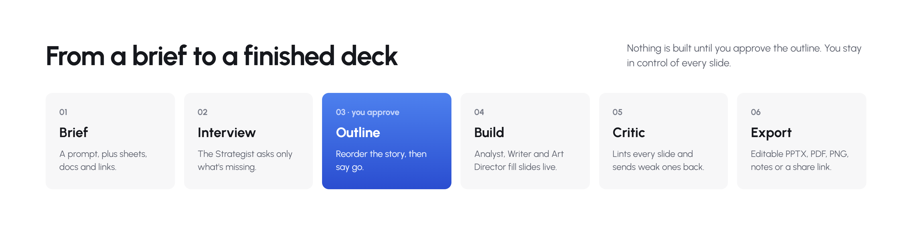
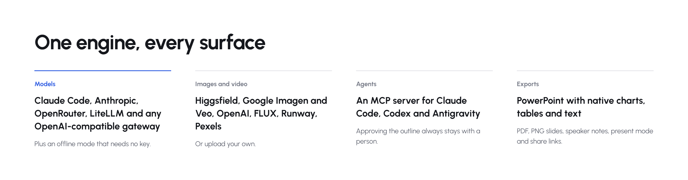

<p align="center">
  
</p>

Lectern turns a prompt, plus your spreadsheets, documents and links, into a finished presentation. You can edit every part of it and export it as PowerPoint, PDF or slide images.

It is a full product with a web app and a backend engine, not a chat skill.

<p align="center">
  
</p>

1. **Brief.** Describe the deck, or attach data and documents.
2. **Interview.** The Strategist asks only the questions your brief left open.
3. **Outline.** Reorder the storyline and approve it. Nothing is built before you do.
4. **Build.** The agents fill the slides live, and you can pause and resume.
   - The Analyst computes every number from real cells in your data.
   - The Writer drafts the text and the Art Director picks layouts and visuals.
5. **Critic.** Every slide is linted, and weak ones go back for another pass.
6. **Export.** Editable PPTX with native charts and tables, PDF, PNG, speaker notes, present mode or a share link.

Every slide is a typed scene graph on a 1920×1080 canvas. The web view, PowerPoint, PDF and images are all rendered from that one source, so they always match.

<p align="center">
  
</p>

Add provider keys on the **Connections** page. Keys stay on your machine. The MCP server runs with `uv run lectern-mcp`, or over HTTP at `/mcp`.

## Repository

| Folder | What it is |
|---|---|
| `server/` | FastAPI + SQLModel engine: agents, 21 layouts, the Critic, exporters, brand kits from `.potx`, linked data sources, media router, share links and MCP server. |
| `web/` | Next.js 15 app: new deck, interview, outline, editor, data studio, media, sources, brand kits, connections, present mode and share viewer. |
| `docs/SPEC.md` | The contract between the backend and the web app. |
| `references/` | Layout, deck-type and visual-design knowledge the agents draw on. |

## Run it

You need Python 3.12+ with [uv](https://docs.astral.sh/uv/), and Node 20+ with pnpm.

```sh
# Backend: http://localhost:8000 (API docs at /docs)
cd server
uv sync
uv run uvicorn lectern.main:app --port 8000

# Web app: http://localhost:3000
cd web
pnpm install
pnpm dev
```

`pnpm dev:mock` runs the web app on mock data without the backend. Without any key, the backend uses its offline provider. Connect a model to get real writing.

## Test

```sh
cd server && uv run pytest              # backend tests, run offline
cd web && pnpm typecheck && pnpm lint
```

See `server/README.md` for environment variables.
