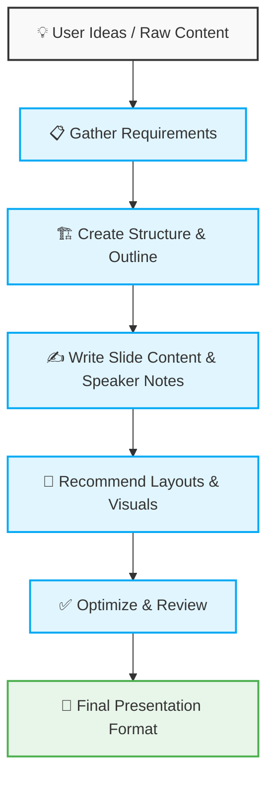
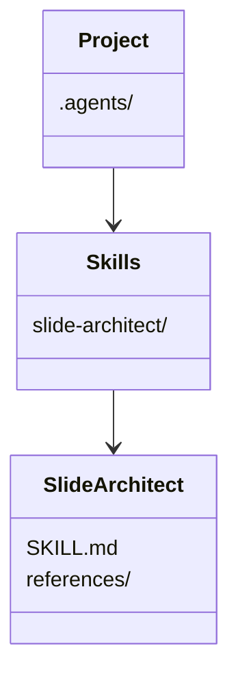
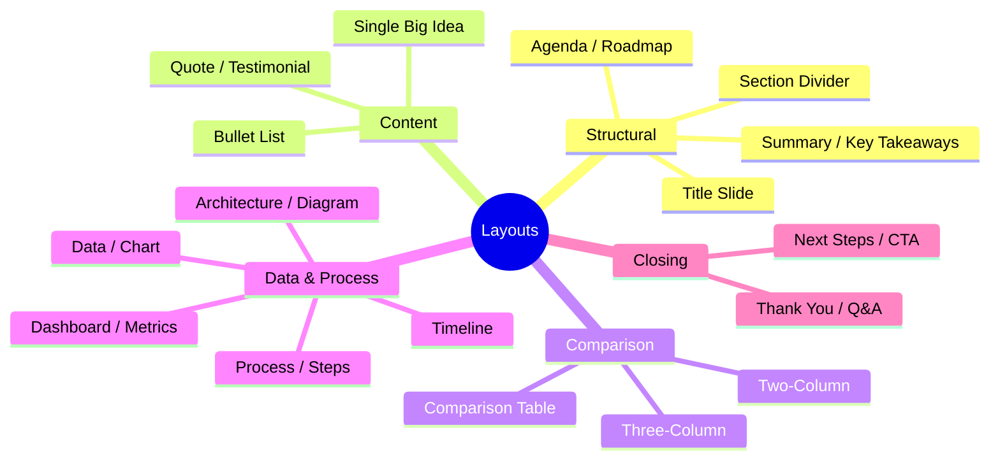

# 📊 SlideArchitect

<p align="center">
  
</p>

[](#)
[](#)

A Claude skill for building professional PowerPoint presentations and slide decks from scratch.

## 🌟 Overview

This skill transforms Claude into a dedicated **presentation strategist, content writer, and slide designer**. It helps you create polished, presentation-ready slide decks tailored to your topic, audience, and specialized goals.

---

## ✨ Features

- 🏗 **Structured Workflow** - Step-by-step process from idea to finished deck
- 📐 **Smart Layout Suggestions** - 20+ slide layout patterns for any content type
- 🎯 **Deck Type Specialization** - Optimized for business reviews, sales pitches, investor decks, training materials, technical architecture, case studies, and more
- 🎨 **Visual Guidance** - Recommendations for charts, icons, colors, typography, and imagery
- 📝 **Speaker Notes** - Generated presentation notes for each slide
- 🔄 **Content Transformation** - Converts rough ideas, meeting notes, documents, and case studies into slide format
- 🔀 **Multi-Variant Output** - Create short, detailed, client-facing, or internal versions

---

## ⚙️ How It Works



---

## 🚀 Installation

### Option 1: Project-Level (Recommended for Teams)

Copy the `slide-architect` folder to your project's `.agents/skills/` directory:



### Option 2: User-Level (Available Across All Projects)

Copy the `slide-architect` folder to your user skills directory:

**Windows:**
```cmd
%USERPROFILE%\.claude\skills\
```

**macOS/Linux:**
```bash
~/.claude/skills/
```

### Option 3: Packaged Skill

Use the provided `slide-architect.skill` file:
1. Extract the `.skill` file (it's a ZIP archive)
2. Place the `slide-architect` folder in one of the locations above

---

## 💬 Usage

Once installed, simply tell Claude what you need:

### 🎯 Creating a New Deck
- *"Create a 10-slide sales deck for our new analytics platform targeting e-commerce companies"*
- *"Build an investor pitch deck for a Series A fintech startup"*
- *"Make a training presentation on cybersecurity awareness for new employees"*

### 🔄 Transforming Content
- *"Turn these meeting notes into a presentation for the leadership team"*
- *"Convert this 20-page report into a 15-slide executive summary"*
- *"Transform this case study into a slide deck for our sales team"*

### 🛠 Improving Existing Slides
- *"Rewrite these slides to be more concise and executive-friendly"*
- *"Restructure this deck to flow better and suggest visuals for each slide"*

---

## 📋 What Claude Will Ask

For best results, be ready to share:

| Element | Example |
|---------|---------|
| **Topic** | "Q3 Business Review" or "Product Launch" |
| **Purpose** | Inform, persuade, train, pitch, or decide? |
| **Audience** | Executives, clients, investors, technical team? |
| **Tone** | Formal, conversational, persuasive? |
| **Length** | Target slide count or time limit |
| **Source Material** | Documents, notes, data, or starting fresh? |

---

## 📄 Output Format

Claude provides a copy-paste friendly structure:

```markdown
# [Deck Title]

## Slide 1: Title Slide
**Layout:** Title + Subtitle
**Visual:** Company logo, professional background

**Title:** [Title Text]
**Subtitle:** [Subtitle Text]
**Notes:** [Opening hook, speaker introduction]

---

## Slide 2: [Slide Title]
**Layout:** [Layout Type]
**Visual:** [Specific recommendation]

**Title:** [Slide Title]

- Bullet 1
- Bullet 2
- Bullet 3

**Speaker Notes:** What to say while this slide is shown
```

---

## 🧩 Supported Deck Types

- **Business Review** - Executive updates, status reports
- **Sales Deck** - Product pitches, proposals
- **Investor Pitch** - Fundraising presentations
- **Training** - Educational materials, workshops
- **Technical Architecture** - System design, technical reviews
- **Case Study** - Success stories, proof points
- **Strategy Review** - Strategic planning, board presentations
- **Project Status** - Stakeholder updates, sprint reviews
- **Town Hall** - Company-wide communications

---

## 📚 Slide Layouts Available



---

## 💡 Tips for Best Results

1. **Be specific about your audience** - "C-suite executives" vs "general audience" produces very different content
2. **Share source materials** - Paste documents, notes, or data for Claude to work from
3. **Request specific layouts** - Ask for "a timeline slide" or "comparison table" when you know what you need
4. **Iterate** - Ask for variations: "Make this shorter" or "Add more technical detail"
5. **Use the variants feature** - Request multiple versions: "Give me a 5-slide summary and a 15-slide detailed version"
6. **Ask for visual suggestions** - Claude can recommend specific charts, icons, and imagery
7. **Request speaker notes** - Always ask for notes if you'll be presenting live

---

## 📁 File Structure

```text
slide-architect/
├── README.md              # This file
├── SKILL.md               # Core instructions for Claude
└── references/
    ├── layout-patterns.md     # 20+ slide layout templates
    ├── deck-types.md          # Specialized deck guidance
    └── visual-guidelines.md   # Charts, colors, typography
```

---

## 📖 Examples

### Example 1: Sales Deck
**You:** *"Create a sales deck for a B2B SaaS product that helps companies automate invoice processing"*

**Claude will:**
1. Ask about target audience (accountants, CFOs, operations?)
2. Create a 10-12 slide outline
3. Generate compelling content focused on business outcomes
4. Suggest layouts and visuals
5. Provide speaker notes

### Example 2: Meeting Notes to Slides
**You:** *"Turn these notes into a presentation" [paste meeting notes]*

**Claude will:**
1. Extract key decisions and action items
2. Structure into problem/solution/outcome format
3. Create slides with appropriate context
4. Suggest visuals to support key points

### Example 3: Technical Architecture
**You:** *"Build a technical architecture deck explaining our new microservices migration"*

**Claude will:**
1. Structure current state → proposed state → migration plan
2. Suggest diagrams for each architecture view
3. Include risk assessment and timeline slides
4. Provide technical depth appropriate to the audience

---

## 📄 License

This skill is provided as-is for use with Claude. Modify and extend as needed for your organization.

---

**Questions or suggestions?** This skill is designed to be extended. Feel free to modify the reference files or `SKILL.md` to match your organization's specific presentation standards and templates.
